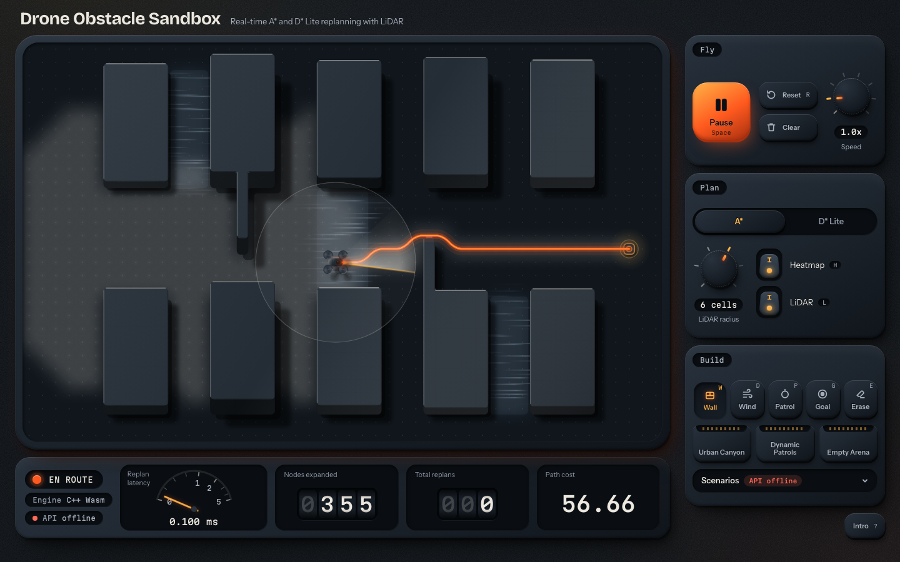

# Autonomous Drone & Obstacle-Avoidance Sandbox

A browser sandbox where a drone plans and re-plans its route through a city grid in real
time. The pathfinding engine is C++17 (A* and incremental D* Lite) compiled to
WebAssembly; a React + TypeScript + Canvas app renders it at 60 FPS; a Fastify +
PostgreSQL service stores scenarios and mission telemetry.



**Live demo:** https://ilay-fisher.github.io/drone-obstacle-sandbox/ (the demo runs in the browser only, with no backend, so saving and loading scenarios is disabled; run the full stack locally for persistence).

**First visit:** a ten-second guided intro plays once (a city, an A* route, a wall, a D* Lite repair, then "Your turn"). Esc or any click skips it; press `?` or use the Intro key in the console to replay it. `?intro=0` turns it off and `?intro=1` forces it (handy for demos and screenshots). With reduced motion it is a static four-panel card instead.

Delivery plan and per-workstream reports: `docs/WORKFLOW.html`, `docs/reports/`.

## Architecture

```
 +---------------------------- Browser ----------------------------+
 |                                                                  |
 |  React UI (ControlPanel, TelemetryHud)                           |
 |        |                                                         |
 |  DroneCanvas  --60 FPS rAF loop-->  plannerBridge.ts             |
 |        ^                               |            |            |
 |        |  zero-copy Uint8Array views   |            | fallback   |
 |        |                               v            v            |
 |  +-----+---------- Wasm linear memory --------+  TS planner      |
 |  |  grid_[w*h] uint8   visited_heat_[w*h]     |  (same algos)    |
 |  |  path_[w*h] int32   node pool, binary heap |                  |
 |  +-----------------^--------------------------+                  |
 |                    | embind (bindings.cpp)                       |
 |            DronePlanner (planner.cpp, C++17, -O3)                |
 +-------------------------------|----------------------------------+
                                 | fetch /api (Vite proxy)
                                 v
            Fastify API (TypeScript, zod, pino)  :3001
                                 |
                                 v
                     PostgreSQL 16 (scenarios, runs)
```

## Tech stack

| Layer | Technology |
|---|---|
| Engine | C++17, Emscripten 4.0.10 (embind), Docker-based build |
| Frontend | React 18, TypeScript (strict), Vite, HTML5 Canvas, Vitest |
| Backend | Node.js 24, Fastify, zod, pino, PostgreSQL 16, SQL migrations, Vitest |
| Ops | Docker Compose, GitHub Actions CI (C++, Wasm, server, web jobs) |

## Run it

Prerequisites: Docker, Node.js 20+.

```bash
docker compose up -d            # PostgreSQL + API on :3001
./cpp/build.sh                  # optional: rebuild Wasm (runs inside emscripten/emsdk image)
cd web && npm install && npm run dev
```

If port 3001 or 5432 is taken, override them: `API_PORT=3101 DB_PORT=55432 docker compose up -d`
and start the web app with `API_TARGET=http://localhost:3101 npm run dev`.

Open http://localhost:5173. API docs (OpenAPI / Swagger UI) are at http://localhost:3001/docs. Without the API the sandbox still works; only save/load and
run history are disabled. Without the Wasm build the app falls back to the TypeScript
planner and the HUD shows `TS Fallback`.

Tests:

```bash
g++ -std=c++17 -O2 cpp/planner.cpp cpp/test_planner.cpp -o /tmp/test_planner && /tmp/test_planner
cd server && npm test
cd web && npm test
```

## A* vs D* Lite

- **A\*** searches from scratch on every replan. Simple, optimal with an admissible
  heuristic (octile distance), and cheap on small grids, but its cost grows with the whole
  search area each time an obstacle moves.
- **D\* Lite** searches backward from the goal and keeps its `g`/`rhs` values between
  calls. When a cell changes, only the inconsistent nodes around it are repaired, so a
  replan after a local change usually expands far fewer nodes. The cost is more memory
  (two values per cell plus a key-ordered queue) and more complex code; a new goal resets it.
- Both use an 8-connected grid, octile heuristic, no corner cutting, and a 4x cost for wind
  zones, so the drone trades a longer route for a cheaper one when that pays off.
- The replan animation's flood order is reconstructed by BFS in JS (over the visited heat cells, from the drone or goal), because the engine exposes expansion counts, not expansion order.

## Repository layout

```
cpp/        C++ engine, embind bindings, Wasm build script, unit tests
web/        Vite + React visualizer
server/     Fastify REST API, migrations, tests
docs/       CONTRACTS.md (interfaces), WORKFLOW.html (plan), reports/
```

## License

MIT
